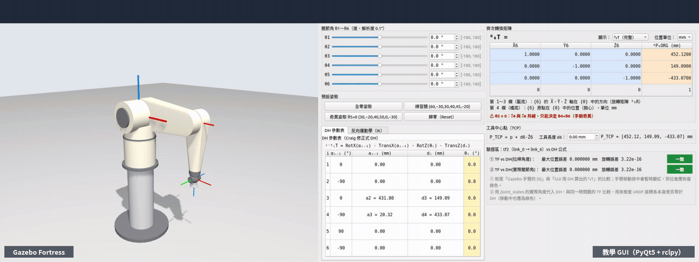
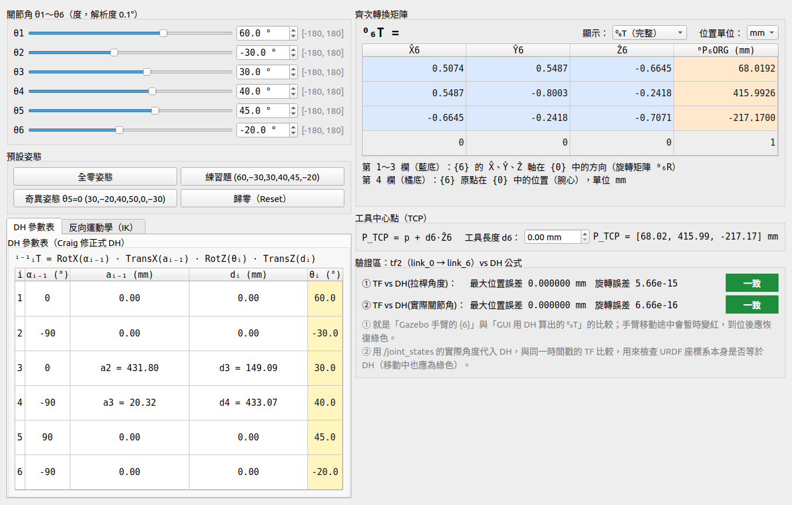
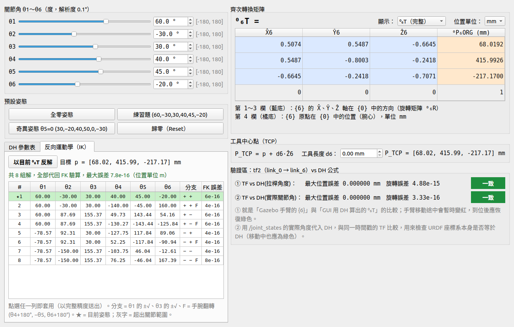
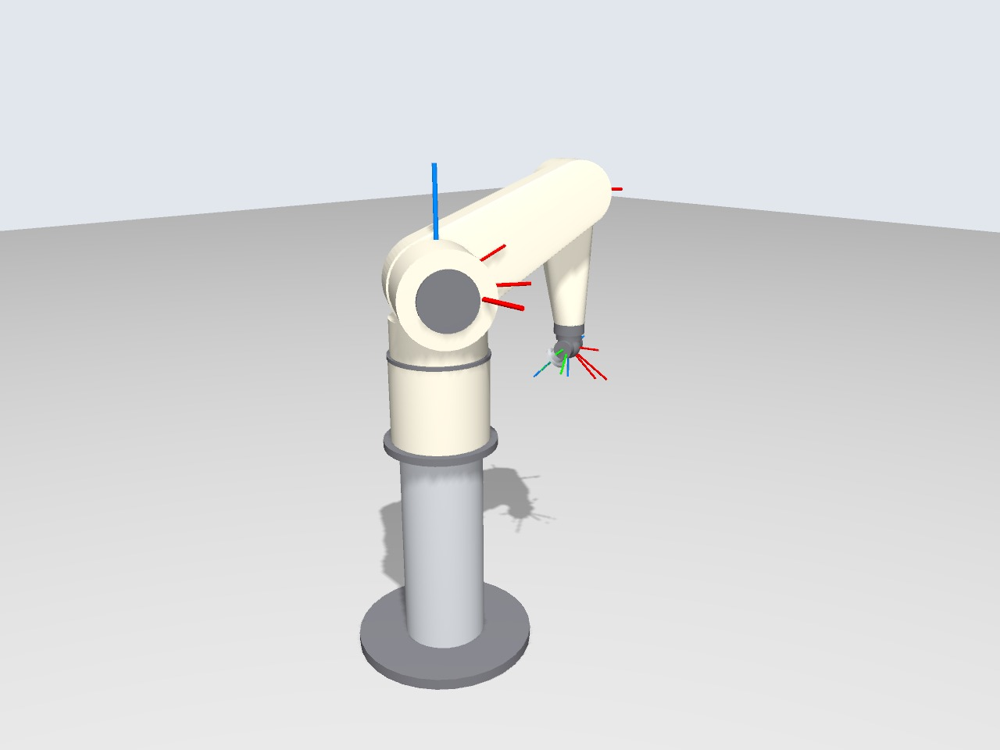
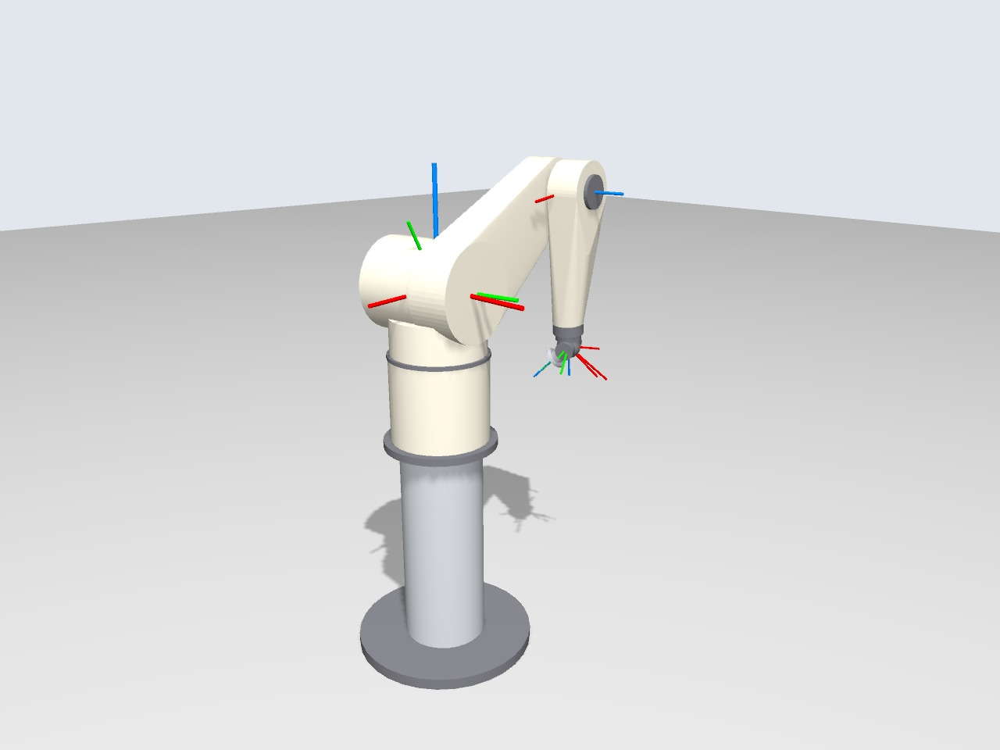
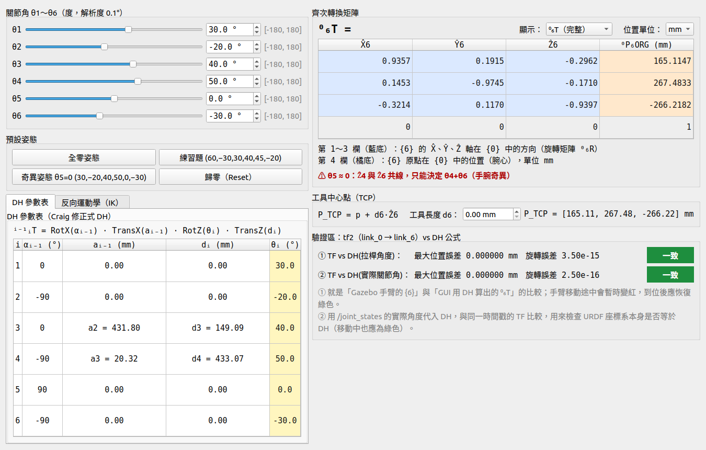

# PUMA560 正向／反向運動學教學模擬（ROS 2 Humble + Gazebo Fortress）

依照 Craig《Introduction to Robotics》4th ed. **修正式 DH（modified DH）** 建立的 PUMA560 教學輔助教材：

- Gazebo 中顯示 PUMA560，每個 link 的座標系 **≡ Craig DH 座標系 {0}～{6}**
- PyQt5 GUI：6 個拉桿控制 θ1～θ6，Gazebo 手臂即時跟著動
- 即時顯示 ⁰₆T（以及 ⁰₁T…⁵₆T、¹₃T、³₆T、¹₆T）
- 驗證區：tf2 實際查詢 `link_0 → link_6`，與 DH 公式比對
- 反向運動學：以目前 ⁰₆T 反解全部 8 組閉合解，點選即套用

## 示範



▶ [觀看完整影片（MP4，1920×720，55 秒）](docs/demo.mp4)

影片內容：拖曳拉桿 → 練習題姿態（⁰₆T 與講義答案一致）→ 切換 ¹₃T、³₆T → 奇異姿態提示 → TCP → 反向運動學 8 組解逐一套用 → 歸零。
影片與截圖都是用 [`tools/record_demo/record_demo.sh`](tools/record_demo/) 自動錄製的，GUI 或外觀改版後可以一個指令重錄。

### 截圖

| 正向運動學：練習題姿態 (60, −30, 30, 40, 45, −20) | 反向運動學：8 組解 |
|---|---|
|  |  |

| 同一個 ⁰₆T：第 1 組解（原姿態） | 同一個 ⁰₆T：第 7 組解（另一種構型） |
|---|---|
|  |  |

| 奇異姿態 θ5 = 0：GUI 顯示提示 |
|---|
|  |

---

## 1. 安裝

測試環境：Ubuntu 22.04.5、ROS 2 Humble、Gazebo Fortress（`libignition-gazebo6` 6.18.0）。

本專案實際用到的 apt 套件：

```bash
sudo apt install \
  ros-humble-desktop \
  ros-humble-ros-gz \
  ros-humble-gz-ros2-control \
  ros-humble-ros2-control ros-humble-ros2-controllers \
  ros-humble-xacro ros-humble-robot-state-publisher \
  ros-humble-joint-state-publisher-gui \
  python3-numpy python3-scipy python3-pyqt5 python3-yaml python3-pytest
```

> **ros2_control 外掛名稱（已查證）**：Humble + Fortress 使用 `ros-humble-gz-ros2-control`（0.7.x）。
> URDF 中的 hardware plugin 是 `gz_ros2_control/GazeboSimSystem`，
> Gazebo system plugin 是 `libgz_ros2_control-system.so`（類別 `gz_ros2_control::GazeboSimROS2ControlPlugin`）。
> `ros-humble-ign-ros2-control` 只是舊名稱的相容套件，本專案沒有使用它。

## 2. 編譯

```bash
cd ~/puma560_ws
source /opt/ros/humble/setup.bash
colcon build
source install/setup.bash
```

## 3. 啟動

```bash
# 主要啟動指令：Gazebo + 手臂 + 控制器 + GUI
ros2 launch puma560_gazebo teaching.launch.py

# 另外開 RViz2 看 TF 座標軸（講解座標系時很好用）
ros2 launch puma560_gazebo teaching.launch.py rviz:=true
```

| 參數 | 預設 | 說明 |
|---|---|---|
| `rviz` | `false` | `true`：開啟 RViz2，顯示每個 link 的 TF 座標軸與名稱 |
| `gui` | `true` | 是否開啟教學 GUI |
| `show_axes` | `true` | 是否在模型上畫出紅 X／綠 Y／藍 Z 座標軸 |
| `joint_limits` | `default` | `default`＝全部 ±180°；`real`＝PUMA560 實際範圍（**僅供參考**，見下方） |
| `software_rendering` | `false` | `true`：設定 `LIBGL_ALWAYS_SOFTWARE=1`（虛擬機 / 無 GPU） |
| `render_engine` | `ogre2` | 軟體渲染時建議改成 `ogre` |
| `world` | 本套件的 `teaching.sdf` | 改用其他 Gazebo world（例如錄影時加上相機的 world） |

**虛擬機或沒有 GPU 時：**

```bash
ros2 launch puma560_gazebo teaching.launch.py software_rendering:=true render_engine:=ogre
```

**只看座標系（不開 Gazebo）**：RViz2 + `joint_state_publisher_gui`

```bash
ros2 launch puma560_description display.launch.py
```

**用指令直接控制手臂**（6 個值，單位 rad）：

```bash
ros2 topic pub --once /forward_position_controller/commands std_msgs/msg/Float64MultiArray \
  "{data: [1.0472, -0.5236, 0.5236, 0.6981, 0.7854, -0.3491]}"
```

### 測試

```bash
cd ~/puma560_ws && source install/setup.bash
python3 -m pytest src/puma560_teaching_gui/test src/puma560_description/test -v -p no:anyio

# 或使用 colcon
colcon test && colcon test-result --verbose
```

- `test_kinematics.py`：指示中的全零姿態、練習題姿態、(90,0,−90,0,0,0)，以及 100 組隨機姿態的 RᵀR = I、det R = +1
- `test_ik.py`：第 5 節第 5 項，1000 組隨機姿態 × 8 組解代回 FK（誤差 < 1e-6），且原本的角度一定在 8 組解之中；另外測試手腕翻轉關係、奇異姿態、無解與關節範圍
- `test_urdf_matches_dh.py`：把 xacro 展開成 URDF，**只依 URDF 規則**（origin → rpy → 繞 axis 轉）連乘 joint，在 202 組姿態下逐一比對 {1}～{6} 都等於 DH 公式

> `-p no:anyio`：若 `~/.local` 裡裝了新版 `anyio`，它的 pytest 外掛和系統 pytest 6.2 不相容，會讓 pytest 無法啟動。
> `src/puma560_teaching_gui/pytest.ini` 已經設定好，在該目錄執行時不需要加這個參數。

---

## 4. GUI 說明

| 區塊 | 說明 |
|---|---|
| **關節角 θ1～θ6** | 拉桿解析度 0.1°。右邊的數字欄可以直接輸入（按 Enter 套用），兩者同步。拉動時即時發布命令（rad）到 `/forward_position_controller/commands` |
| **預設姿態** | 全零姿態、練習題 (60,−30,30,40,45,−20)、奇異姿態 θ5=0 (30,−20,40,50,0,−30)、歸零（Reset：關節歸零，並把顯示的矩陣、單位、TCP 長度恢復預設） |
| **DH 參數表** | 直接從 `dh_params.yaml` 讀取，θ 欄即時顯示目前角度；a、d 欄位會跟著單位切換 |
| **齊次轉換矩陣** | 預設顯示 ⁰₆T。4×4、等寬字型、小數 4 位；**藍底**＝旋轉部分，**橘底**＝位置欄。下拉選單可以切換 ⁰₁T…⁵₆T（各連桿）以及 ¹₃T、³₆T、¹₆T（講義的分組乘法）。位置單位可切換 mm / m |
| **奇異點提示** | 當 \|sin θ5\| < 0.01 時顯示「θ5 ≈ 0：Ẑ4 與 Ẑ6 共線，只能決定 θ4+θ6」 |
| **工具中心點** | 輸入工具長度 d6（mm），顯示 P_TCP = p + d6·Ẑ6 |
| **驗證區** | 見下方說明 |
| **反向運動學（IK）分頁** | 位於左下角，和「DH 參數表」切換。按「以目前 ⁰₆T 反解」會列出全部 8 組解，點選任一列就把拉桿設成那組角度。詳見第 5.4 節 |

### 驗證區的兩行

1. **① TF vs DH(拉桿角度)**：用 tf2 查詢 Gazebo 手臂實際的 `link_0 → link_6`，和 GUI 用 DH 公式算出的 ⁰₆T 比較，並顯示最大位置誤差（mm）。誤差小於 0.01 mm 時顯示綠色「一致」，否則顯示紅色。
   **手臂移動途中會暫時變紅**，這是正常的（Gazebo 還沒追上命令），到位後（約 0.3 秒）應該恢復綠色。
2. **② TF vs DH(實際關節角)**：拿 `/joint_states` 回報的實際角度代入 DH 公式，和**同一時間戳**的 TF 比較。這一行檢查的是「URDF 座標系本身是否等於 DH」，所以即使手臂正在移動也應該保持綠色。

實測結果：到位後兩行的位置誤差都是 0.000000 mm，旋轉誤差約 1e-15。

---

## 5. DH 參數與 URDF 原理

### 5.1 Craig 修正式 DH

```
^{i-1}_i T = RotX(α_{i-1}) · TransX(a_{i-1}) · RotZ(θ_i) · TransZ(d_i)

         [ cθ       -sθ       0     a_{i-1}  ]
       = [ sθ·cα    cθ·cα    -sα   -sα·d_i   ]
         [ sθ·sα    cθ·sα     cα    cα·d_i   ]
         [ 0         0        0     1        ]
```

| i | α_{i-1} | a_{i-1} | d_i | θ_i |
|---|---|---|---|---|
| 1 | 0 | 0 | 0 | θ1 |
| 2 | −90° | 0 | 0 | θ2 |
| 3 | 0 | a2 = 431.8 mm | d3 = 149.09 mm | θ3 |
| 4 | −90° | a3 = 20.32 mm | d4 = 433.07 mm | θ4 |
| 5 | +90° | 0 | 0 | θ5 |
| 6 | −90° | 0 | 0 | θ6 |

慣例：{0} 在 θ1 = 0 時與 {1} 重合；{6} 原點在腕心（d6 = 0）。

**唯一的參數來源**：`src/puma560_description/config/dh_params.yaml`。URDF（xacro）和 GUI 都讀這一份，修改這裡兩邊會同時改變。

### 5.2 為什麼 URDF joint origin = [a, −sα·d, cα·d]、rpy = [α, 0, 0]

URDF 的 joint 是「先套 `<origin>`（先平移，再依 rpy 旋轉），再繞 `<axis>` 轉關節角」。

1. RotZ(θ) 和 TransZ(d) 都沿著同一個 Z 軸，所以**可以交換**：
   `RotX(α)·TransX(a)·RotZ(θ)·TransZ(d) = RotX(α)·TransX(a)·TransZ(d)·RotZ(θ)`
2. 前面固定不動的部分 `RotX(α)·TransX(a)·TransZ(d)`：
   - 旋轉部分 = RotX(α) → 就是 `rpy="α 0 0"`
   - 平移部分 = RotX(α)·[a, 0, d]ᵀ = [a, −sinα·d, cosα·d]ᵀ → 就是 `xyz`
3. 剩下的 RotZ(θ) → `<axis xyz="0 0 1"/>`

所以 xacro 巨集（`puma560.urdf.xacro` 中的 `dh_joint`）是：

```xml
<origin xyz="${a} ${-sin(α)*d} ${cos(α)*d}" rpy="${α} 0 0"/>
<axis xyz="0 0 1"/>
```

並用遞迴巨集 `dh_chain` 依 DH 表自動產生 joint_1～joint_6，沒有任何手算的數字。
因此 TF 上的 `link_0 → link_i` 就等於 ⁰ᵢT（已由 `test_urdf_matches_dh.py` 驗證）。

### 5.3 其他設計說明

- **底座架高**：全零姿態時腕心在 {0} 下方 433 mm，所以加了一個固定的 `world → link_0`，把 {0} 架高 1.0 m（xacro 參數 `base_height`）。它只影響 {0} 在世界中的位置，**不影響 ⁰₆T**。
- **外觀**：仿 PUMA560 的造型與配色（Unimation 米白色機身、深灰色關節與手腕、金屬灰支架）：
  深色地板法蘭 → 金屬支架 → 機身 → 腰部 → 橫向的肩部圓筒 → 錐形上臂 → 並排（偏移 d3）的前臂 → 手腕 → 工具法蘭。
  - 上臂與前臂是 mesh，由 `scripts/generate_meshes.py` 在 **colcon build 時依 `dh_params.yaml` 自動產生**（點集合的 3D 凸包），所以長度永遠和 DH 參數一致；產物在 `install/.../meshes/`，不放進 git。
  - 所有 mesh 都已經放在該 link 的 DH 座標系中，visual 的 origin 為 0；**joint 的 origin 完全沒有改動**，`test_urdf_matches_dh.py` 照樣驗證。
  - 這仍是「示意」外觀，不是原廠 CAD 尺寸。
- **座標軸**：{4}{5}{6} 三個座標系的原點都在腕心，所以座標軸會重疊；為了方便分辨，三組座標軸的長度不同（{4} 最短，{6} 最長）。腕心的黃色小球位於手腕外殼內部，在 RViz 中（RobotModel 半透明）比較容易看到。
- **沒有 collision**：重力已經關閉，而且這套教材只看運動學，所以沒有加入碰撞模型（手臂可以穿過自己）。
- **關節範圍 `real`（僅供參考）**：θ1 ±160°、θ2 −225°～45°、θ3 −45°～225°、θ4 −110°～170°、θ5 ±100°、θ6 ±266°。這是常見的引用值，**沒有對照原廠手冊查證**，而且不同書的關節零點不一定和 Craig 的座標系相同。若講義有提供數值，請修改 `config/joint_limits.yaml`。

### 5.4 反向運動學（PUMA560 閉合解）

實作在 `puma560_kinematics.py` 的 `Puma560.ik()`，使用講義公式的**已修正**版本：

```
θ1  = atan2(py, px) − atan2(d3, ±√(px² + py² − d3²))
K   = (px² + py² + pz² − a2² − a3² − d3² − d4²) / (2·a2)
θ3  = atan2(a3, d4) − atan2(K, ±√(a3² + d4² − K²))
u   = c1·px + s1·py
θ23 = atan2( (−a3 − a2c3)·pz − u·(d4 − a2s3),  (a2s3 − d4)·pz + (a3 + a2c3)·u ),  θ2 = θ23 − θ3
θ4  = atan2(−r13·s1 + r23·c1,  −r13·c1·c23 − r23·s1·c23 + r33·s23)
−s5 = r13(c1c23c4 + s1s4) + r23(s1c23c4 − c1s4) − r33(s23c4)
 c5 = −r13·c1·s23 − r23·s1·s23 − r33·c23
 s6 = −r11(c1c23s4 − s1c4) − r21(s1c23s4 + c1c4) + r31(s23s4)
 c6 = r11[(c1c23c4 + s1s4)c5 − c1s23s5] + r21[(s1c23c4 − c1s4)c5 − s1s23s5] − r31(s23c4c5 + c23s5)
手腕翻轉：(θ4 + 180°, −θ5, θ6 + 180°)
```

- **8 組解** = θ1 的 ±√（2）× θ3 的 ±√（2）× 手腕是否翻轉（2）。表格的「分支」欄依序標示這三個選擇，例如 `+ − F`。
- **關於 θ23 的符號**：實測 500 組隨機姿態，使用修正後的「**+** (a3 + a2c3)·u」時，最大誤差為 3e-15；若改回「−」，誤差會到 1.05，可見原文確實印錯。
- **每組解都會代回 FK 驗算**，表格最後一欄就是誤差（位置以 m 計），一般在 1e-16～1e-15 之間。
- **手腕奇異（θ5 = 0）**：此時 θ4 的 atan2 兩個參數都是 0，θ4 無法決定（只有 θ4 + θ6 確定）。程式會取**目前的 θ4**，再依此算出 θ6，並顯示紅色提示。
- **無解**：腕心超出可達範圍（a3² + d4² < K²），或落在肩部偏移 d3 的圓柱內（px² + py² < d3²），會顯示原因。
- **關節範圍**：IK 的角度一律正規化到 (−180°, 180°]。套用時，程式會嘗試對每個角度 ±360° 讓它落在目前的關節範圍內，放不進去的解以灰字顯示、無法套用。例如練習題姿態在 `joint_limits:=real` 下，只有第 1、7、8 組可以套用。
- **套用的精度**：點選後以完整精度送出命令，所以 ⁰₆T 和反解的目標完全一致；拉桿與數字欄只是顯示四捨五入到 0.1° 的值。
- **換解的時間**：URDF 的關節速度上限是 3 rad/s，在兩組相差很多的解之間切換時（例如 θ6 轉 180°），手臂約需 1.5 秒才到位，期間驗證區 ① 會暫時變紅。

---

## 6. 專案結構

```
~/puma560_ws/src/
├── puma560_description/        # ament_cmake
│   ├── config/dh_params.yaml       ← 唯一的 DH 參數
│   ├── config/joint_limits.yaml
│   ├── urdf/puma560.urdf.xacro     ← DH 巨集自動產生 joint
│   ├── scripts/generate_meshes.py  ← build 時產生上臂、前臂 mesh
│   ├── launch/display.launch.py    ← RViz2 + joint_state_publisher_gui
│   ├── rviz/puma560.rviz
│   └── test/test_urdf_matches_dh.py
├── puma560_gazebo/             # ament_cmake
│   ├── worlds/teaching.sdf         ← 重力 0、地板、光源
│   ├── config/controllers.yaml     ← forward_position_controller + joint_state_broadcaster
│   └── launch/teaching.launch.py   ← 主要 launch
└── puma560_teaching_gui/       # ament_python
    ├── puma560_teaching_gui/puma560_kinematics.py   ← 純 Python（不依賴 ROS），FK + IK
    ├── puma560_teaching_gui/gui_node.py
    └── test/test_kinematics.py、test/test_ik.py

~/puma560_ws/
├── docs/                       # 示範影片、README 截圖
└── tools/record_demo/          # 錄製示範影片的工具（見該目錄的 README）
```

---

## 7. 常見問題

**Q1. Gazebo 黑畫面、閃退，或出現 OpenGL / EGL 錯誤**
- 虛擬機或沒有 GPU：`ros2 launch puma560_gazebo teaching.launch.py software_rendering:=true render_engine:=ogre`
- 雙顯卡筆電出現 `libEGL warning: egl: failed to create dri2 screen` 是無害的警告，可以忽略。
- 上一次的 Gazebo 沒有完全關閉：`pkill -f "ign gazebo"` 後再重新啟動。

**Q2. 控制器沒啟動，手臂不動**
- 檢查：`ros2 control list_controllers`，應該看到 `joint_state_broadcaster` 和 `forward_position_controller` 都是 `active`。
- 如果看不到 `/controller_manager`：通常是 Gazebo 外掛沒有載入。確認已安裝 `ros-humble-gz-ros2-control`，並查看 launch 輸出中有沒有 `gz_ros2_control` 相關的錯誤。
- GUI 是在控制器啟動「之後」才開啟的；如果 GUI 一直沒出現，代表 spawner 卡住了，請看 launch 輸出。

**Q3. 驗證區顯示「TF 查不到」**
- 確認 `robot_state_publisher` 正在執行：`ros2 node list`
- 確認有 `/joint_states`：`ros2 topic echo --once /joint_states`
- 確認 `/clock` 有在發布（`use_sim_time` 需要）：`ros2 topic hz /clock`
- 手動查詢：`ros2 run tf2_ros tf2_echo link_0 link_6`

**Q4. ① 一直是紅色**
- 手臂移動途中變紅是正常的。如果靜止後仍然是紅色，先看 ② 是否為綠色：② 綠、① 紅，代表手臂沒有到達命令位置（可能是 Gazebo 暫停了，請按 Gazebo 左下角的播放鍵）。

**Q5. `/joint_states` 的順序和 joint_1～6 不同**
- 這是正常的（實測順序為 1,2,4,5,3,6）。GUI 是依關節「名稱」對應，不會受影響；自己寫程式時也請依名稱對應。

**Q6. pytest 出現 `ModuleNotFoundError: No module named '_pytest.scope'`**
- 這是 `~/.local` 中新版 `anyio` 的 pytest 外掛造成的，加上 `-p no:anyio` 即可。

---

## 授權

本專案採用 [Apache License 2.0](LICENSE) 授權（與各套件 `package.xml` 中的宣告一致）。

DH 參數、公式與練習題數值引自 John J. Craig《Introduction to Robotics: Mechanics and Control》4th ed. 及課程講義，僅供教學使用。
